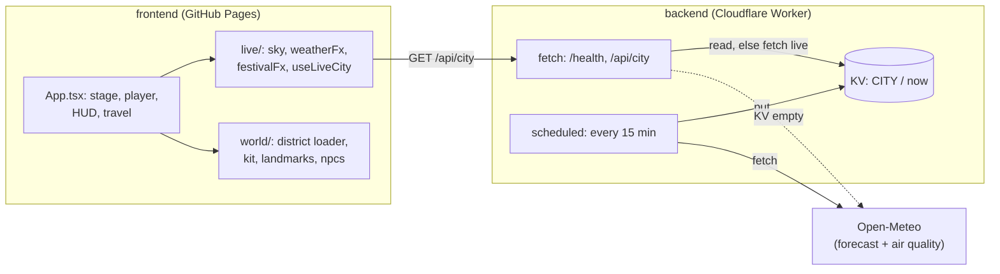

# Architecture

How phase 1 fits together: a static React + Three.js site on GitHub Pages and a small Cloudflare Worker that
serves the city's live snapshot (weather, air quality, sunrise and sunset, today's festival). There are no
accounts, rooms or other players yet; those arrive in phases 2 and 3.

For setup and secrets see [deployment.md](./deployment.md); for phone measurements see
[device-performance.md](./device-performance.md). The design and plan live in
[docs/superpowers](./superpowers/); where they disagree with this file, the code wins.

## Packages

npm workspaces (root `package.json`): `frontend` and `backend`.

| Package    | What it is                                                          | Key entry points                                                              |
| ---------- | ------------------------------------------------------------------- | ----------------------------------------------------------------------------- |
| `frontend` | React 19 + Vite 8 + Three.js site, served from GitHub Pages         | `src/main.tsx`, `src/App.tsx`, `src/engine/stage.ts`, `src/world/district.ts` |
| `backend`  | Cloudflare Worker (`gulabi-gali-api`): `/health`, `/api/city`, cron | `src/index.ts`, `src/weather.ts`, `src/festivals.ts`, `wrangler.jsonc`        |

`/api/city` answers from KV; on a miss it fetches Open-Meteo itself, and if that fails it returns a default
snapshot flagged `stale`. The browser never calls Open-Meteo. If the API cannot be reached the client uses a
local default (`fallbackSnapshot` in `src/net/api.ts`) and the city still opens.

## Engine and quality tiers

`src/engine/stage.ts` owns the WebGL renderer, scene, camera and the one animation loop. Everything that moves
(player, characters, weather and festival effects) runs from `stage.onFrame`, so pausing the stage pauses all
of it. Adaptive quality measures every frame: if over 60% of about 2.5 s took longer than 22 ms it steps one
tier down, and never back up in that tab session (remembered in `sessionStorage['gg-quality']`).

| Tier | Pixel ratio cap | Shadows |
| ---- | --------------- | ------- |
| 2    | 2               | sun     |
| 1    | 1.25            | none    |
| 0    | 1               | none    |

## How districts stream

There are four districts (`walled-city`, `mi-road`, `university`, `malviya-nagar`). Each one's definition is a
dynamic `import()` in `src/world/district.ts`, so each is its own small chunk, fetched only when the player
first goes there. `loadDistrict(id)` builds the geometry from the definition: building blocks are merged per
60 m cell (few draw calls, still culled off-screen), props are baked, and the district gets one hemisphere
light and one sun whose shadow box follows the player (`district.focus`).

Travel is by metro (`src/world/useTravel.ts`, `ui/TravelSheet.tsx`). The new district is loaded first, and only
once it is in does the old one leave; if loading fails the player stays where they were. Three.js is its own
`three` chunk (`vite.config.ts`), so its hash survives deploys that only touch the app.

The remembered district and the collected stamps (9 landmarks) live in `localStorage` (`src/storage.ts`).

## Live city

`useLiveCity` fetches `/api/city` and refreshes it; `live/sky.ts` turns the snapshot and the clock into sky,
fog and light colours (recomputed every 30 s), `live/weatherFx.ts` adds rain, and `live/festivalFx.ts`
draws the festival of the day (Sankranti kites, Diwali diyas, Holi colour) and its banner. The festival table
is `backend/src/festivals.data.ts`.

## Test hooks

Opening the site with `?gg-test=1` installs `window.__gg` (`src/testHooks.ts`), once the district is in:
`quality`, `framesSinceRestore`, `position`, `teleport`, `district`, `sky`, `festival`, `npcs`, `setSnapshot`,
`setNow`. `?gg-festival=<id>` stands in for the live festival, in test mode only. Without `gg-test=1` nothing
is installed. The Playwright specs in `frontend/tests` and `tests/device-perf.spec.ts` use these.

## The protocol-copy rule

The wire types (`CitySnapshot`, `FestivalId`, `DistrictId`) are written once in `backend/src/protocol.ts` and
copied byte for byte to `frontend/src/net/protocol.ts`; the two packages share no code at build time.
`npm run check:protocol` (`scripts/check-protocol.mjs`, also a CI step) fails if the copies differ. Edit the
backend file, then copy it over.

## Build and security

- A production build needs `VITE_API_URL` (the API origin) and fails without it; `GG_ALLOW_LOCAL_API=1`
  opts in to the local Worker (e2e and previews).
- A Content-Security-Policy `<meta>` is generated at build time (`vite.config.ts`) from that origin, with
  any inline script allowed by hash. Google Fonts load from `index.html` (`preconnect` plus a `display=swap`
  stylesheet), not from CSS, so they do not block first paint.
- The Worker's CORS list (`backend/src/cors.ts`) is the site's origin plus the local dev origins.
