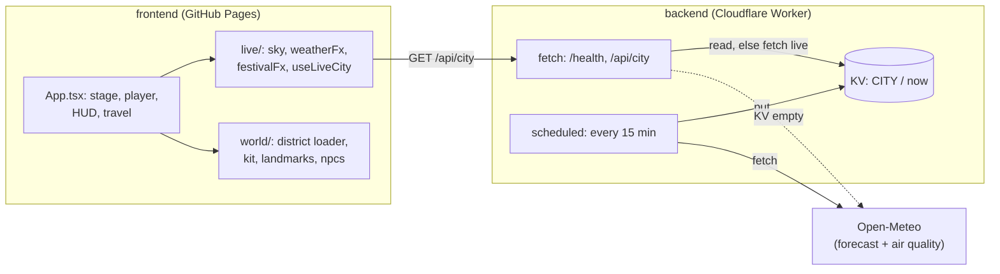
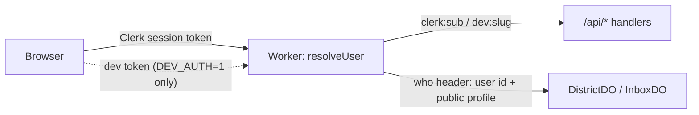
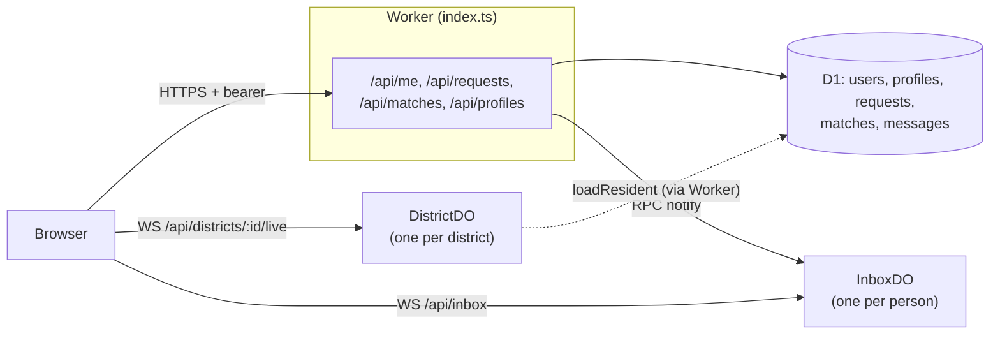

# Architecture

How phases 1 to 3 fit together: a static React + Three.js site on GitHub Pages and a Cloudflare Worker that
serves the city's live snapshot (weather, air quality, sunrise and sunset, today's festival), signs people in,
keeps their profiles, shows residents to one another live, and carries "milna hai" requests and one-to-one
chat, and, since phase 3, keeps the city safe: trust tiers, a word filter, blocks, reports, rate limits, an
owner's admin page, a cap with a waitlist, and account deletion.

For setup and secrets see [deployment.md](./deployment.md); for phone measurements see
[device-performance.md](./device-performance.md). The design and plan live in
[docs/superpowers](./superpowers/); where they disagree with this file, the code wins.

## Packages

npm workspaces (root `package.json`): `frontend` and `backend`.

| Package    | What it is                                                                | Key entry points                                                                   |
| ---------- | ------------------------------------------------------------------------- | ---------------------------------------------------------------------------------- |
| `frontend` | React 19 + Vite 8 + Three.js site, served from GitHub Pages               | `src/main.tsx`, `src/App.tsx`, `src/engine/stage.ts`, `src/world/district.ts`      |
| `backend`  | Cloudflare Worker (`gulabi-gali-api`): city, API, two Durable Objects, D1 | `src/index.ts`, `src/district.ts`, `src/inbox.ts`, `src/auth.ts`, `wrangler.jsonc` |

`/api/city` answers from KV; on a miss it fetches Open-Meteo itself, and if that fails it returns a default
snapshot flagged `stale`. The browser never calls Open-Meteo. If the API cannot be reached the client uses a
local default (`fallbackSnapshot` in `src/net/api.ts`) and the city still opens.

## Engine and quality tiers

`src/engine/stage.ts` owns the WebGL renderer, scene, camera and the one animation loop. Everything that moves
(player, characters, weather and festival effects) runs from `stage.onFrame`, so pausing the stage pauses all
of it. Adaptive quality measures every frame: if over 60% of about 2.5 s took longer than 22 ms it steps one
tier down, and never back up in that tab session (remembered in `sessionStorage['gg-quality']`).

| Tier | Pixel ratio cap | Shadows |
| ---- | --------------- | ------- |
| 2    | 2               | sun     |
| 1    | 1.25            | none    |
| 0    | 1               | none    |

## How districts stream

There are four districts (`walled-city`, `mi-road`, `university`, `malviya-nagar`). Each one's definition is a
dynamic `import()` in `src/world/district.ts`, so each is its own small chunk, fetched only when the player
first goes there. `loadDistrict(id)` builds the geometry from the definition: building blocks are merged per
60 m cell (few draw calls, still culled off-screen), props are baked, and the district gets one hemisphere
light and one sun whose shadow box follows the player (`district.focus`).

Travel is by metro (`src/world/useTravel.ts`, `ui/TravelSheet.tsx`). The new district is loaded first, and only
once it is in does the old one leave; if loading fails the player stays where they were. Three.js is its own
`three` chunk (`vite.config.ts`), so its hash survives deploys that only touch the app.

The remembered district and the collected stamps (9 landmarks) live in `localStorage` (`src/storage.ts`).

## Live city

`useLiveCity` fetches `/api/city` and refreshes it; `live/sky.ts` turns the snapshot and the clock into sky,
fog and light colours (recomputed every 30 s), `live/weatherFx.ts` adds rain, and `live/festivalFx.ts`
draws the festival of the day (Sankranti kites, Diwali diyas, Holi colour) and its banner. The festival table
is `backend/src/festivals.data.ts`.

## Test hooks

Opening the site with `?gg-test=1` installs `window.__gg` (`src/testHooks.ts`), once the district is in:
`quality`, `framesSinceRestore`, `position`, `teleport`, `district`, `sky`, `festival`, `npcs`, `people`,
`setSnapshot`, `setNow`. `?gg-festival=<id>` stands in for the live festival, in test mode only. Both are needed: the hooks exist only in a build made with `VITE_TEST_HOOKS=1` (the e2e build; the shipped one
drops them) and only on a page opened with `gg-test=1`. The Playwright specs in `frontend/tests` and `tests/device-perf.spec.ts` use these.

## The protocol-copy rule

The wire types (`CitySnapshot`, `FestivalId`, `DistrictId`, the live and inbox messages, profile and request
shapes) are written once in `backend/src/protocol.ts` and
copied byte for byte to `frontend/src/net/protocol.ts`; the two packages share no code at build time.
`npm run check:protocol` (`scripts/check-protocol.mjs`, also a CI step) fails if the copies differ. Edit the
backend file, then copy it over.

## Build and security

- A production build needs `VITE_API_URL` (the API origin) and fails without it; `GG_ALLOW_LOCAL_API=1`
  opts in to the local Worker (e2e and previews).
- A Content-Security-Policy `<meta>` is generated at build time (`vite.config.ts`) from that origin, with
  any inline script allowed by hash. Google Fonts load from `index.html` (`preconnect` plus a `display=swap`
  stylesheet), not from CSS, so they are no longer chained behind the CSS bundle; preconnect + display=swap keeps text
  visible while the font loads.
- `VITE_DEV_AUTH=1` (a sign-in that needs only a name) makes a production build fail unless
  `GG_ALLOW_LOCAL_API=1` is also set, so it cannot ship by accident. It is for e2e and local builds only.
- The Worker's CORS list (`backend/src/cors.ts`) is the site's origin plus the local dev origins.

## Phase 2: meeting people

### Who is who: identity and tiers

The frontend picks one sign-in mode per build (`src/auth/useAuth.ts`, `authMode`): **clerk** when
`VITE_CLERK_PUBLISHABLE_KEY` is set (email code or Google; the Clerk SDK is a lazy chunk, so the app mounts
first and the SDK reports in later), else **dev** when `VITE_DEV_AUTH=1` (type a name, get a token from the
Worker's `/api/dev/login`), else **none** (everyone is a ghost). The browser sends its token as
`Authorization: Bearer ...`, or as `?token=` on a WebSocket upgrade, where headers cannot be set.

The Worker (`src/auth.ts`, `resolveUser`) turns a token into a user id: `clerk:` after verifying the Clerk
JWT (offline against `CLERK_JWT_KEY` if set, otherwise against Clerk's key set fetched with `CLERK_SECRET_KEY`
and cached per isolate; the token's `azp` must be one of our origins), or `dev:<slug>` for an HMAC-signed
`dev.<slug>.<mac>` token, accepted **only** when `DEV_AUTH=1`.

Tiers (phase 2):

| Tier         | Who                                                                          | What it gets                                                                                                                |
| ------------ | ---------------------------------------------------------------------------- | --------------------------------------------------------------------------------------------------------------------------- |
| **Ghost**    | no token, or a token with no complete profile (or a banned user)             | Receives the city and the people in it. Is never shown to others; cannot sit, speak or send requests.                       |
| **Resident** | a token plus a complete profile: name, look, home area, `adult` and `pledge` | Is shown on the map (name, look and the profile's status), sits on benches, sends and answers requests, chats with matches. |

Anyone may be sent a request by any resident who has not paused requests. A verified tier above resident is
coming in phase 3; today every resident has the same rights.

### Live presence: DistrictDO

One `DistrictDO` per district (`walled-city`, `mi-road`, `university`, `malviya-nagar`), named by district id.
The client opens `GET /api/districts/:id/live` (`src/net/live.ts`); the Worker checks the district and the
page's Origin, resolves the caller, **drops any client-sent `X-GG-Who` header** and hands the upgrade to the
object with a fresh `X-GG-Who` of its own (the JSON percent-encoded, so any name is plain ASCII), which the
object trusts. Sockets are hibernating (the object sleeps while nobody moves), and what must survive a sleep
(who sits where, each point) is kept in socket attachments; a point is written at most once a second, a seat
change or a close at once.

- The object learns a resident's name, look and status when their socket opens. A saved profile that changes
  any of them makes the client reconnect, and the new socket shows the new face to everyone (the socket's own
  `status` message works but the client does not use it).
- Moves are validated (finite, in range, at most 8 m/s with a one-second burst allowance), coalesced per
  person and sent out every 100 ms to sockets within 60 m of the mover's last point. A resident's client sends
  at most 10 a second, a ghost's 2; the client hides bodies more than 55 m away, and empties the street when
  its socket is replaced or has been down for 3 s.
- Each socket has token-bucket lanes (`move` 12 a second with a burst of 15, `status`, `say`, `other`);
  refusals touch memory only, a flood is told `rate` once and closed after 3 s. Five bad frames in a row close
  the socket. A socket silent for 30 s is closed and its person leaves. A second socket for the same person
  replaces the first.
- **Benches** (`benches.json`, the tapris and benches of each district, 4 seats each): a resident within 3 m
  sits, lines go to everyone on that bench and into an in-memory transcript (last 10 minutes, at most 200
  lines). Bench chat is never written to D1 or any other storage. Walking more than 2.5 m away stands you up.
  So that a bench report can carry those 10 minutes, a bench with any line left keeps its object awake with a
  self-renewing timer (it lets go 10 minutes after the last line), and the object remembers who sat where for
  as long, so someone who only listened can still report. A deploy, or the runtime evicting the object anyway,
  still loses both.
- **Caps:** a district holds at most `MAX_DISTRICT_SOCKETS` sockets (400 unless the var says otherwise), ghosts
  included, and at most `MAX_IP_SOCKETS` (24) from one address (`CF-Connecting-IP`, carried in `X-GG-Who`;
  generous for mobile carriers' shared addresses; IPv6 counts by its /64; loopback is exempt for local dev).
  One more is told `full` and closed with 4005, before D1 is asked anything.
- **Trust** (phase 3): each connected person's blocks and mute live in the object's memory, never in an
  attachment (whose size is capped), loaded from D1 on connect and, after a wake, before the first frame is
  handled. Two people blocked either way never hear of each other. Any change to a person (ban, hide, mute,
  block, profile) goes through `refreshUser` (`backend/src/refresh.ts`), which tells all four districts and
  the person's inbox to reload them: a ban closes their sockets with 4004, a hide makes them a ghost on the
  spot, a mute refuses `say` and `status` with `muted`. A target that fails is retried once; past that, each
  district's alarm reloads everyone connected at least once a minute. After D1 fails to answer, a district
  waits 3 s before asking again (dropping frames meanwhile).
- **Hidden** people get no new contact: off the map, their profile card a 404, out of others' request lists,
  and no new requests or matches either way. What already exists goes on: they keep their own requests,
  matches, chats and inbox, and a match they already had stays in the other member's list, to read, write,
  report or end. `ACTIVE` and `VISIBLE` in
  `backend/src/profiles.ts` are the two rules.
- The client side: `src/world/session.ts` wires a district's systems on enter and disposes them on leave;
  `src/world/people.ts` draws remote residents (shadows only at tier 2);
  `useBench.ts` and `ui/BenchChat.tsx` are the bench UI.

### Requests, matches and chat: D1 and InboxDO

D1 (`backend/migrations/0001_people.sql`) is the system of record:

| Table      | Holds                                                                                                                                    |
| ---------- | ---------------------------------------------------------------------------------------------------------------------------------------- |
| `users`    | id (`clerk:...` or `dev:...`), `created_at`, `banned`; from `0002_trust.sql`: `hidden`, `muted_until`, `verified`, `verified_by`         |
| `profiles` | one per user: name, `look`, home area, status, here-for, about, link, `adult`, `pledge`, `pause_requests`                                |
| `requests` | from, to, reason (10 to 140 characters), `state` (`pending`, `accepted`, `ignored`); one pending request per pair; expires after 14 days |
| `matches`  | a pair (`a` < `b`), created when a request is accepted                                                                                   |
| `messages` | match id, sender, body (at most 500 characters, 10 lines), time; at most one per second per sender                                       |

Routes (all need a token except `/api/dev/login`, which exists only under `DEV_AUTH=1`): `GET /api/me`,
`PUT /api/me/profile`, `GET /api/profiles/:id`, `POST /api/requests`, `GET /api/requests`,
`POST /api/requests/:id/accept|ignore`, `GET /api/matches`, `DELETE /api/matches/:id` (unmatch),
`GET|POST /api/matches/:id/messages`. Anything in a match is a 404 to someone who is not in it.
`GET /api/profiles/:id` is for residents only (anyone else is 403 `ghost`). Unmatching leaves an `ignored`
request from the other person to the one who unmatched, dated then, so the other cannot ask straight back for
14 days; it is never listed.

`InboxDO` (one per user, `inbox:<userId>`) holds that user's open `GET /api/inbox` sockets (up to 5; a sixth
closes the oldest; residents only). It carries **notices only**: after a request, an accept, a message or an
unmatch the Worker calls `notify` over RPC and the object tells the person's sockets to refetch. Nothing
important lives in the notice, so a lost one is harmless; the client refetches on reconnect
(`src/net/inbox.ts`, `src/net/reconnect.ts`, `src/connections/useConnections.ts`) and the lists in
`ui/Connections.tsx` and `ui/ChatView.tsx` come from D1.

### The cap and the waitlist: GateDO

One `GateDO` (named `global`, `backend/src/gate.ts`) counts the residents seen across all four districts,
one slot per person however many tabs or districts they have open; `MAX_LIVE` (default 300) is the most it
admits. A district asks it (`admit`) before anyone hears of a resident, and `release`s the slot when that
person's last resident socket there closes. Slots are kept per (person, district), so a metro ride never
counts twice, and the last one is held for 20 s, so a reload or a ride (the old socket closes before the new
one opens) takes it straight back. Each district's alarm vouches for whoever it holds (`heartbeat`); a slot
nobody has vouched for in 2 minutes (a crashed or evicted district) is let go. It all lives in the object's
SQLite storage, so it survives hibernation.

Over the cap, the resident's socket stays open as a ghost and is told its place in line (`welcome` with
`you.queued`, then `{t:'queued', position}` as it moves up). The line is ordered by first ask and keyed by
user id, so a reload keeps the place; someone with no live socket for 10 minutes is dropped. When a slot
frees, the gate tells the first live one's district (`promote`), whose socket becomes a resident at once. A
person who redeemed an invite in the last 24 hours (looked up by the Worker and passed in `X-GG-Who`) skips
the line, up to `MAX_LIVE` + 10%. The page shows a dismissible card (`ui/FullScreen.tsx`) with the position
and an email field, `POST /api/waitlist` (no sign-in; 5 an hour per address; stored once, always 204). No
email is sent: the owner writes to people from the admin page's CSV.

## Phase 3: safety

The plan is `docs/superpowers/plans/2026-11-14-phase-3-safety.md`; the schema is `backend/migrations/0002_trust.sql`.

### Trust tiers and invites (`trust.ts`)

Ghost (no complete profile), resident (visible; can sit, talk at benches, receive and accept requests) and
verified (can also **send** requests, sees others' links, holds 2 invite codes). A person becomes verified by
redeeming an invite code (`POST /api/invites/redeem`, one conditional `UPDATE ... WHERE used_by IS NULL`, so a
code is won once) or by an admin's mark, which also hands out their codes. There is no phone OTP. The first
verified member is the owner, who marks themselves on the admin page; that bootstraps every invite after.
`users` carries `verified`, `verified_by`, `hidden`, `muted_until` and `banned`.

Residency has two rules in SQL (`ACTIVE`, `VISIBLE` in `profiles.ts`): active is a complete profile and not
banned; visible is active and not hidden. Every residency check goes through them.

### Word filter (`filter/`)

Names, statuses, about, request reasons, chat, bench lines and posters are checked. Text is normalised
(lowercase, NFKC, leetspeak, repeated letters collapsed, separators stripped) and matched on whole tokens and
known compounds from `filter/words.ts`. A hit answers `{ ok: false, reason: 'words', field }`. The client has
the same check for a hint while typing (`filter/WordsHint`); the server has the last word.

### Blocks (`blocks.ts`)

Symmetric and total: the two never see each other in districts, person cards, requests or chats. A block deletes
pending requests between them, ends any match (through `endMatch`, which holds the chat as evidence first) and
stands the blocked person up from a shared bench. The blocked person is told nothing. The `blocks` row keeps the
blocked person's first name from block time, so the block list never shows live profile data.

### Live changes reach live sockets (`refresh.ts`)

After any trust change is written to D1, `refreshUser(env, id, why)` tells each district and the person's
inbox to reload them (`ban`, `hide`, `mute`, `block`, `profile`, `delete`). A target that fails is retried
once; the districts' alarm re-checks everyone connected about every minute as a backstop.
Close codes (`LIVE_CLOSE`): replaced 4001, invalid 4002, idle 4003, banned 4004, full 4005, deleted 4006.

### Reports and evidence (`reports.ts`, `evidence.ts`)

A report is about a person, bench, chat or poster. The server assembles the evidence itself (a client-sent
transcript is ignored): a bench's in-memory transcript of the last 10 minutes (only if the reporter sat there),
a chat's last 30 messages (only for its members), or a profile snapshot. Evidence is visible only to admins, and
is deleted when the report is closed or 30 days after it was filed (the cron). When a chat ends (an unmatch, a
block, a deletion), its last 30 messages are copied into `held_evidence` for 30 days so it can still be
reported. Three distinct **verified** reporters within 7 days hide a person until an admin acts; residents'
reports are queued but never count. A report the server could not confirm (a bench whose district had slept)
is `unconfirmed` and never counts either.

### Rate limits (`limits.ts`)

Per address, three Workers Rate Limiting bindings (sockets 120 a minute, sign-ins 20 a minute, writes 300 a
minute) plus an hourly invite-redemption count in D1; loopback is exempt only in dev. Per account, D1
`counters`: requests 5 a day for an account under 7 days old and 20 after, messages 30 a minute, reports 20 a
day. A refusal is a 429 with `Retry-After`, and the page says so (`net/rateNotice.ts`).

### Admin (`admin.ts`, `frontend/src/admin/`)

Every `/api/admin/*` route is a 404 unless the caller's id is in `ADMIN_USER_IDS`. The page is `#/admin`,
a lazy chunk so it is never in the city bundle. It lists the report queue with evidence, looks people up, and
ban, unban, mute (24 hours), unmute, verify and unhide them, shows live stats and exports the waitlist as CSV.
A ban closes sockets, hides the person and blocks writes; it is idempotent.

### The gate

`GateDO` and the waitlist are described under phase 2 above. In phase 3 it also lets in a recently invited
person up to 10% over the cap, and `release(..., forget)` frees the slot and place in line at once for anyone
banned, hidden or deleted.

### Account deletion (`account.ts`)

`DELETE /api/me` (a banned person gets 403 first, so it is no way out of a ban). Every match ends through
`endMatch(..., 'delete')`, holding its last 30 messages as evidence, and the other person hears `unmatched`.
Then one D1 batch deletes the profile, every request in either direction, the invites they own, the blocks they
made and their counters, sets `reporter = 'deleted'` on reports they filed (their evidence is kept), and deletes
the `users` row. Blocks others made against them stay, so they still protect their owners if the id returns;
reports about them stay until closed. The `users` row is kept as a tombstone (verified cleared) only while a
hide or mute on it still holds. Sockets close with 4006 and the gate forgets them. The page then signs out;
signing in again gives a blank profile. The Clerk sign-in account is not touched (see deployment.md). The
privacy note (`ui/PrivacySheet.tsx`, linked from the intro and the profile sheet) says all of this in plain
words.
