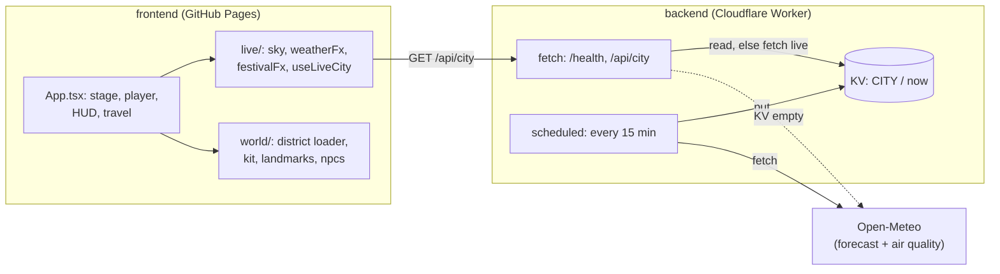
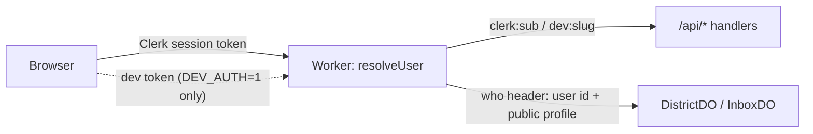
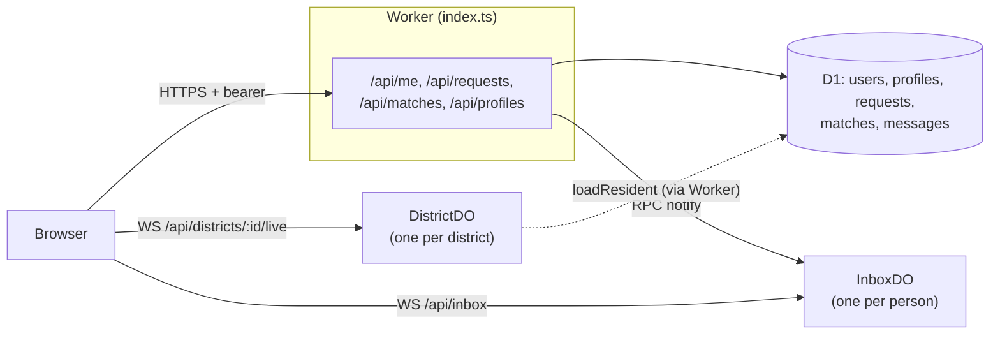

# Architecture

How phases 1 and 2 fit together: a static React + Three.js site on GitHub Pages and a Cloudflare Worker that
serves the city's live snapshot (weather, air quality, sunrise and sunset, today's festival), signs people in,
keeps their profiles, shows residents to one another live, and carries "milna hai" requests and one-to-one
chat. The verified tier, reports, admin tools and the waitlist are coming in phase 3; none of them exists yet.

For setup and secrets see [deployment.md](./deployment.md); for phone measurements see
[device-performance.md](./device-performance.md). The design and plan live in
[docs/superpowers](./superpowers/); where they disagree with this file, the code wins.

## Packages

npm workspaces (root `package.json`): `frontend` and `backend`.

| Package    | What it is                                                                | Key entry points                                                                   |
| ---------- | ------------------------------------------------------------------------- | ---------------------------------------------------------------------------------- |
| `frontend` | React 19 + Vite 8 + Three.js site, served from GitHub Pages               | `src/main.tsx`, `src/App.tsx`, `src/engine/stage.ts`, `src/world/district.ts`      |
| `backend`  | Cloudflare Worker (`gulabi-gali-api`): city, API, two Durable Objects, D1 | `src/index.ts`, `src/district.ts`, `src/inbox.ts`, `src/auth.ts`, `wrangler.jsonc` |

`/api/city` answers from KV; on a miss it fetches Open-Meteo itself, and if that fails it returns a default
snapshot flagged `stale`. The browser never calls Open-Meteo. If the API cannot be reached the client uses a
local default (`fallbackSnapshot` in `src/net/api.ts`) and the city still opens.

## Engine and quality tiers

`src/engine/stage.ts` owns the WebGL renderer, scene, camera and the one animation loop. Everything that moves
(player, characters, weather and festival effects) runs from `stage.onFrame`, so pausing the stage pauses all
of it. Adaptive quality measures every frame: if over 60% of about 2.5 s took longer than 22 ms it steps one
tier down, and never back up in that tab session (remembered in `sessionStorage['gg-quality']`).

| Tier | Pixel ratio cap | Shadows |
| ---- | --------------- | ------- |
| 2    | 2               | sun     |
| 1    | 1.25            | none    |
| 0    | 1               | none    |

## How districts stream

There are four districts (`walled-city`, `mi-road`, `university`, `malviya-nagar`). Each one's definition is a
dynamic `import()` in `src/world/district.ts`, so each is its own small chunk, fetched only when the player
first goes there. `loadDistrict(id)` builds the geometry from the definition: building blocks are merged per
60 m cell (few draw calls, still culled off-screen), props are baked, and the district gets one hemisphere
light and one sun whose shadow box follows the player (`district.focus`).

Travel is by metro (`src/world/useTravel.ts`, `ui/TravelSheet.tsx`). The new district is loaded first, and only
once it is in does the old one leave; if loading fails the player stays where they were. Three.js is its own
`three` chunk (`vite.config.ts`), so its hash survives deploys that only touch the app.

The remembered district and the collected stamps (9 landmarks) live in `localStorage` (`src/storage.ts`).

## Live city

`useLiveCity` fetches `/api/city` and refreshes it; `live/sky.ts` turns the snapshot and the clock into sky,
fog and light colours (recomputed every 30 s), `live/weatherFx.ts` adds rain, and `live/festivalFx.ts`
draws the festival of the day (Sankranti kites, Diwali diyas, Holi colour) and its banner. The festival table
is `backend/src/festivals.data.ts`.

## Test hooks

Opening the site with `?gg-test=1` installs `window.__gg` (`src/testHooks.ts`), once the district is in:
`quality`, `framesSinceRestore`, `position`, `teleport`, `district`, `sky`, `festival`, `npcs`, `people`,
`setSnapshot`, `setNow`. `?gg-festival=<id>` stands in for the live festival, in test mode only. Both are needed: the hooks exist only in a build made with `VITE_TEST_HOOKS=1` (the e2e build; the shipped one
drops them) and only on a page opened with `gg-test=1`. The Playwright specs in `frontend/tests` and `tests/device-perf.spec.ts` use these.

## The protocol-copy rule

The wire types (`CitySnapshot`, `FestivalId`, `DistrictId`, the live and inbox messages, profile and request
shapes) are written once in `backend/src/protocol.ts` and
copied byte for byte to `frontend/src/net/protocol.ts`; the two packages share no code at build time.
`npm run check:protocol` (`scripts/check-protocol.mjs`, also a CI step) fails if the copies differ. Edit the
backend file, then copy it over.

## Build and security

- A production build needs `VITE_API_URL` (the API origin) and fails without it; `GG_ALLOW_LOCAL_API=1`
  opts in to the local Worker (e2e and previews).
- A Content-Security-Policy `<meta>` is generated at build time (`vite.config.ts`) from that origin, with
  any inline script allowed by hash. Google Fonts load from `index.html` (`preconnect` plus a `display=swap`
  stylesheet), not from CSS, so they are no longer chained behind the CSS bundle; preconnect + display=swap keeps text
  visible while the font loads.
- `VITE_DEV_AUTH=1` (a sign-in that needs only a name) makes a production build fail unless
  `GG_ALLOW_LOCAL_API=1` is also set, so it cannot ship by accident. It is for e2e and local builds only.
- The Worker's CORS list (`backend/src/cors.ts`) is the site's origin plus the local dev origins.

## Phase 2: meeting people

### Who is who: identity and tiers

The frontend picks one sign-in mode per build (`src/auth/useAuth.ts`, `authMode`): **clerk** when
`VITE_CLERK_PUBLISHABLE_KEY` is set (email code or Google; the Clerk SDK is a lazy chunk, so the app mounts
first and the SDK reports in later), else **dev** when `VITE_DEV_AUTH=1` (type a name, get a token from the
Worker's `/api/dev/login`), else **none** (everyone is a ghost). The browser sends its token as
`Authorization: Bearer ...`, or as `?token=` on a WebSocket upgrade, where headers cannot be set.

The Worker (`src/auth.ts`, `resolveUser`) turns a token into a user id: `clerk:` after verifying the Clerk
JWT (offline against `CLERK_JWT_KEY` if set, otherwise against Clerk's key set fetched with `CLERK_SECRET_KEY`
and cached per isolate; the token's `azp` must be one of our origins), or `dev:<slug>` for an HMAC-signed
`dev.<slug>.<mac>` token, accepted **only** when `DEV_AUTH=1`.

Tiers (phase 2):

| Tier         | Who                                                                          | What it gets                                                                                                                |
| ------------ | ---------------------------------------------------------------------------- | --------------------------------------------------------------------------------------------------------------------------- |
| **Ghost**    | no token, or a token with no complete profile (or a banned user)             | Receives the city and the people in it. Is never shown to others; cannot sit, speak or send requests.                       |
| **Resident** | a token plus a complete profile: name, look, home area, `adult` and `pledge` | Is shown on the map (name, look and the profile's status), sits on benches, sends and answers requests, chats with matches. |

Anyone may be sent a request by any resident who has not paused requests. A verified tier above resident is
coming in phase 3; today every resident has the same rights.

### Live presence: DistrictDO

One `DistrictDO` per district (`walled-city`, `mi-road`, `university`, `malviya-nagar`), named by district id.
The client opens `GET /api/districts/:id/live` (`src/net/live.ts`); the Worker checks the district and the
page's Origin, resolves the caller, **drops any client-sent `X-GG-Who` header** and hands the upgrade to the
object with a fresh `X-GG-Who` of its own (the JSON percent-encoded, so any name is plain ASCII), which the
object trusts. Sockets are hibernating (the object sleeps while nobody moves), and what must survive a sleep
(who sits where, each point) is kept in socket attachments; a point is written at most once a second, a seat
change or a close at once.

- The object learns a resident's name, look and status when their socket opens. A saved profile that changes
  any of them makes the client reconnect, and the new socket shows the new face to everyone (the socket's own
  `status` message works but the client does not use it).
- Moves are validated (finite, in range, at most 8 m/s with a one-second burst allowance), coalesced per
  person and sent out every 100 ms to sockets within 60 m of the mover's last point. A resident's client sends
  at most 10 a second, a ghost's 2; the client hides bodies more than 55 m away, and empties the street when
  its socket is replaced or has been down for 3 s.
- Each socket has token-bucket lanes (`move` 12 a second with a burst of 15, `status`, `say`, `other`);
  refusals touch memory only, a flood is told `rate` once and closed after 3 s. Five bad frames in a row close
  the socket. A socket silent for 30 s is closed and its person leaves. A second socket for the same person
  replaces the first.
- **Benches** (`benches.json`, the tapris and benches of each district, 4 seats each): a resident within 3 m
  sits, lines go to everyone on that bench and into an in-memory transcript (last 10 minutes, at most 200
  lines). Bench chat is never written to D1 or any other storage. Walking more than 2.5 m away stands you up.
- The client side: `src/world/session.ts` wires a district's systems on enter and disposes them on leave;
  `src/world/people.ts` draws remote residents (shadows only at tier 2);
  `useBench.ts` and `ui/BenchChat.tsx` are the bench UI.

### Requests, matches and chat: D1 and InboxDO

D1 (`backend/migrations/0001_people.sql`) is the system of record:

| Table      | Holds                                                                                                                                    |
| ---------- | ---------------------------------------------------------------------------------------------------------------------------------------- |
| `users`    | id (`clerk:...` or `dev:...`), `created_at`, `banned`                                                                                    |
| `profiles` | one per user: name, `look`, home area, status, here-for, about, link, `adult`, `pledge`, `pause_requests`                                |
| `requests` | from, to, reason (10 to 140 characters), `state` (`pending`, `accepted`, `ignored`); one pending request per pair; expires after 14 days |
| `matches`  | a pair (`a` < `b`), created when a request is accepted                                                                                   |
| `messages` | match id, sender, body (at most 500 characters, 10 lines), time; at most one per second per sender                                       |

Routes (all need a token except `/api/dev/login`, which exists only under `DEV_AUTH=1`): `GET /api/me`,
`PUT /api/me/profile`, `GET /api/profiles/:id`, `POST /api/requests`, `GET /api/requests`,
`POST /api/requests/:id/accept|ignore`, `GET /api/matches`, `DELETE /api/matches/:id` (unmatch),
`GET|POST /api/matches/:id/messages`. Anything in a match is a 404 to someone who is not in it.
`GET /api/profiles/:id` is for residents only (anyone else is 403 `ghost`). Unmatching leaves an `ignored`
request from the other person to the one who unmatched, dated then, so the other cannot ask straight back for
14 days; it is never listed.

`InboxDO` (one per user, `inbox:<userId>`) holds that user's open `GET /api/inbox` sockets (up to 5; a sixth
closes the oldest; residents only). It carries **notices only**: after a request, an accept, a message or an
unmatch the Worker calls `notify` over RPC and the object tells the person's sockets to refetch. Nothing
important lives in the notice, so a lost one is harmless; the client refetches on reconnect
(`src/net/inbox.ts`, `src/net/reconnect.ts`, `src/connections/useConnections.ts`) and the lists in
`ui/Connections.tsx` and `ui/ChatView.tsx` come from D1.

### Coming in phase 3

The verified tier, reports and moderation, the admin tools and the waitlist. They are not in the code; do not
look for them.
