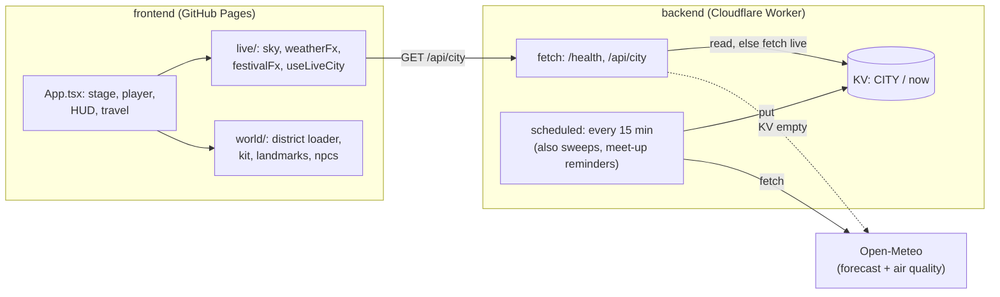
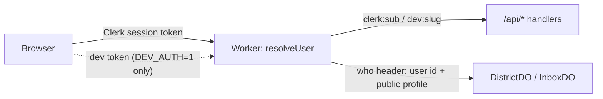
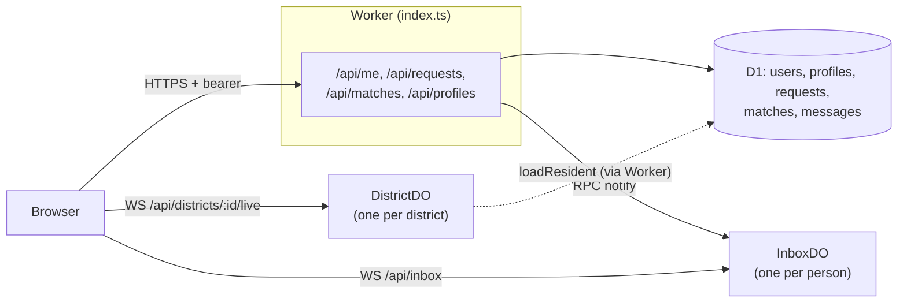
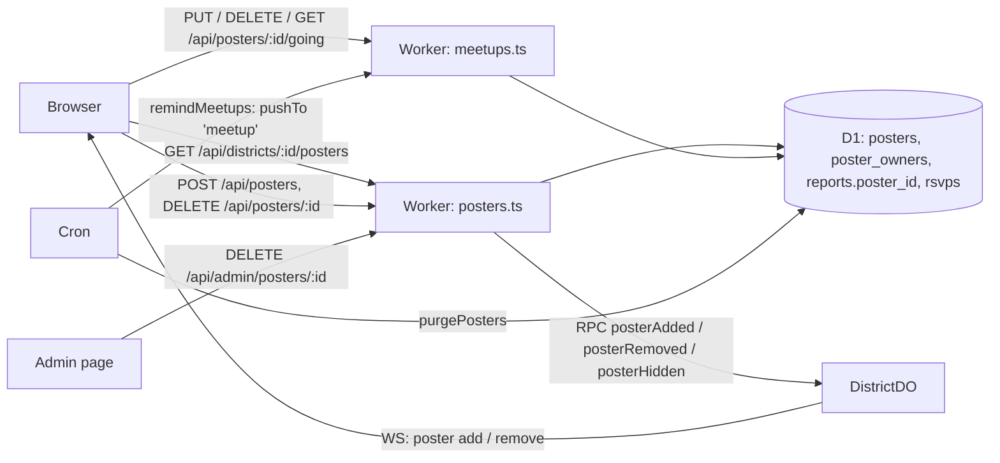
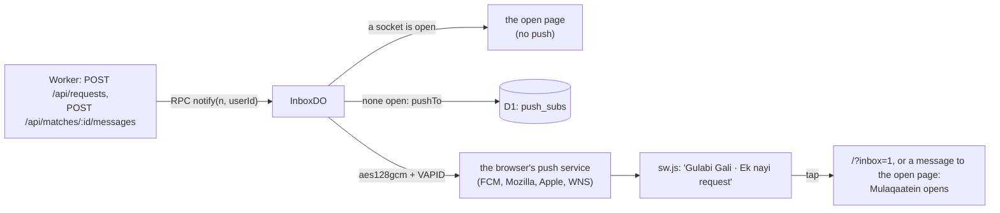

# Architecture

How phases 1 to 4 fit together: a static React + Three.js site on GitHub Pages and a Cloudflare Worker that
serves the city's live snapshot (weather, air quality, sunrise and sunset, today's festival), signs people in,
keeps their profiles, shows residents to one another live, and carries "milna hai" requests and one-to-one
chat. Since phase 3 it keeps the city safe: trust tiers, a word filter, blocks, reports, rate limits, an
owner's admin page, a cap with a waitlist, and account deletion. Phase 4 adds poster walls (the deewar) and
the extras: drivable autos, a metro ride, street animals, Gangaur and Teej processions, a Sankranti kite
fight and the Galta bandar.

For setup and secrets see [deployment.md](./deployment.md); for phone measurements see
[device-performance.md](./device-performance.md). The design and plan live in
[docs/superpowers](./superpowers/); where they disagree with this file, the code wins.

## Packages

npm workspaces (root `package.json`): `frontend` and `backend`.

| Package    | What it is                                                                | Key entry points                                                                   |
| ---------- | ------------------------------------------------------------------------- | ---------------------------------------------------------------------------------- |
| `frontend` | React 19 + Vite 8 + Three.js site, served from GitHub Pages               | `src/main.tsx`, `src/App.tsx`, `src/engine/stage.ts`, `src/world/district.ts`      |
| `backend`  | Cloudflare Worker (`gulabi-gali-api`): city, API, two Durable Objects, D1 | `src/index.ts`, `src/district.ts`, `src/inbox.ts`, `src/auth.ts`, `wrangler.jsonc` |

`/api/city` answers from KV; on a miss it fetches Open-Meteo itself, and if that fails it returns a default
snapshot flagged `stale`. The browser never calls Open-Meteo. If the API cannot be reached the client uses a
local default (`fallbackSnapshot` in `src/net/api.ts`) and the city still opens.

## Engine and quality tiers

`src/engine/stage.ts` owns the WebGL renderer, scene, camera and the one animation loop. Everything that moves
(player, characters, weather and festival effects) runs from `stage.onFrame`, so pausing the stage pauses all
of it. Adaptive quality measures every frame: if over 60% of about 2.5 s took longer than 22 ms it steps one
tier down, and never back up in that tab session (remembered in `sessionStorage['gg-quality']`).

| Tier | Pixel ratio cap | Shadows |
| ---- | --------------- | ------- |
| 2    | 2               | sun     |
| 1    | 1.25            | none    |
| 0    | 1               | none    |

## Camera and looking around

`src/player/camera.ts` is a chase camera that orbits the player. Its default (yaw 0, pitch 0) is the original
view: 7 m behind (+z), 4.5 m up, aimed through head height 5 m beyond the player. Players turn it in two ways:

- **Drag the street.** With a mouse's main button or one finger on the canvas, a drag past the 10 px tap slop
  turns the view. Right turns right, and up tilts up. A drag across the full width turns 225° (`DRAG_TURN`), and
  a vertical drag tilts half as fast. `createInteraction` in `src/world/session.ts` owns this alongside taps: a
  drag is never a tap, a second finger never takes over the look, and the canvas carries `data-looking` while
  turning. Fine pointers then show the `grabbing` cursor; otherwise the canvas keeps the default cursor, because an
  open hand would suggest pulling the other way. A mouse released over a chip or card is never heard letting go.
  Its next hover over the canvas, with no button held, ends the drag. The joystick, HUD, cards and sheets are
  their own DOM elements, so the canvas never hears them. One thumb can hold the stick while the other looks.
- **Q and R** turn left and right at 2 rad/s (`src/player/controls.ts`). E, WASD, the arrows and Space were
  already taken.

Both reach the camera through `controls.addLook` and `controls.look(dt)`, which `player.update` reads every
frame. `controls.freeze` (the kite fight) drops both. Yaw goes all the way round. Pitch stays between
about 14° above the horizon (camera ~2.2 m up) and about 46° down (camera ~6.6 m up), so the camera never
dips under the ground and the view never flips. The view eases into a turn over a few frames, and snaps there
with `prefers-reduced-motion`. Walking is camera-relative (W is into the screen) and never recentres. At the
wheel of an auto the view comes back round behind it once nobody has turned it for 1.5 s. A drag still held
down counts as turning, even a thumb resting still (`controls.holdLook`), so the count starts when it lifts. Mounting does not
whip it round, because only real frames advance that. Only the camera's position lags the player. The view's
heading comes from the yaw alone, so lag slides the camera but never turns the view. The wall pull-in (a ray
from the head to the camera) works at any yaw. A new district starts at yaw 0. `__gg.view()` reads the yaw and
pitch in e2e.

## How districts stream

There are six districts (`walled-city`, `mi-road`, `university`, `malviya-nagar`, `amer`, `nahargarh`). Each one's definition is a
dynamic `import()` in `src/world/district.ts`, so each is its own small chunk, fetched only when the player
first goes there. `loadDistrict(id)` builds the geometry from the definition: building blocks are merged per
60 m cell (few draw calls, still culled off-screen), props are baked, and the district gets one hemisphere
light and one sun whose shadow box follows the player (`district.focus`).

Travel is by metro (`src/world/useTravel.ts`, `ui/TravelSheet.tsx`), except to and from Amer and Nahargarh, which
have no metro (`BUS_ONLY` in `world/metroRide.ts`): a bus runs there from every station and back (`rideBy`). It
takes the same trip, with its own look: a marigold "Bus" row in the sheet, a "Bus" button at the district's bus
stand (its `station`, a `bus-stop` prop), a bus cab instead of the coach, and "Bus stand" on its map and
signposts (the place id stays `metro`).
Amer's lake is `DistrictDef.water`: colliders with no building, drawn by the paving. Its rooftop viewpoint is
the roof of a bastion on the rampart by the lake, turned to look across the water at the fort on its hill.
Nahargarh stands on the ridge above the city: `DistrictDef.ridgeWest` stops the ground at its west wall, and
`DistrictDef.scenery` (`world/landmarks/cityBelow.ts`) draws what lies past it, a low parapet on the edge, a rocky
slope falling 60 m and the city's blocks spread over the plain below. It is only looked at: two meshes, a few
thousand triangles, no colliders, faded by the scene's fog at a lighter density (`CITY_FOG`, a constant in its
shader), so it is hazier the worse the air but still there on a poor day; its lights come on after dark. The
rooftop viewpoint there is a bastion on the terrace by the edge, facing west: the sunset point. Its
`DistrictDef.roofName` makes it a place: the signposts point at its stair, the map pins it (kind `viewpoint`),
and a link (`?at=nahargarh:viewpoint`) stands someone at the stair's foot.
The new district is loaded first, and only
once it is in does the old one leave; if loading fails the player stays where they were. Three.js is its own
`three` chunk (`vite.config.ts`), so its hash survives deploys that only touch the app.

The remembered district and the collected stamps (11 landmarks) live in `localStorage` (`src/storage.ts`). A
resident's stamps are also kept on the server (see "Jaipur Darshan stamps" under phase 4), so a second device
shows them; a ghost's stay on the device.

## Live city

`useLiveCity` fetches `/api/city` and refreshes it; `live/sky.ts` turns the snapshot and the clock into sky,
fog and light colours (recomputed every 30 s), `live/weatherFx.ts` adds rain, and `live/festivalFx.ts`
draws the festival of the day (Sankranti kites, Diwali diyas, Holi colour, and since phase 4 the Gangaur and
Teej processions) and its banner. The festival table is `backend/src/festivals.data.ts`.

The HUD (`ui/Hud.tsx`) keeps to one block at the top of the screen: place, weather and stamps; who can see you;
one card holding the festival greeting, the procession line and the city line; and a group of small switches
(language, sound, and the monkey in the Walled City) down the right edge on a phone, in a row on a wider
screen. Toasts sit under it, and the joystick and cards hold the bottom.

## Test hooks

Opening the site with `?gg-test=1` installs `window.__gg` (`src/testHooks.ts`), once the district is in:
`quality`, `framesSinceRestore`, `position`, `teleport`, `district`, `sky`, `festival`, `npcs`, `freezeNpcs`,
`people`, `liveState`, `setSnapshot`, `setNow`, and from phase 4 `posters`, `animals`, `freezeAnimals`,
`procession`, `forceProcession` (a procession whatever the festival, so the perf run can have one under the
kites), `patang` and `renderInfo` (the renderer's draw calls and memory). `?gg-festival=<id>` stands in for the
live festival, in test mode only. Both are needed: the hooks exist only in a build made with `VITE_TEST_HOOKS=1` (the e2e build; the shipped one
drops them) and only on a page opened with `gg-test=1`. The Playwright specs in `frontend/tests` and `tests/device-perf.spec.ts` use these.
Such a page also draws lite (`testRenderLite`): a pixel ratio of 0.25 and no antialiasing, so CI's
software WebGL keeps up with Playwright; `&gg-full=1` draws in full, and the device perf run passes it.

## The protocol-copy rule

The wire types (`CitySnapshot`, `FestivalId`, `DistrictId`, the live and inbox messages, profile and request
shapes) are written once in `backend/src/protocol.ts` and
copied byte for byte to `frontend/src/net/protocol.ts`; the two packages share no code at build time.
`npm run check:protocol` (`scripts/check-protocol.mjs`, also a CI step) fails if the copies differ. Edit the
backend file, then copy it over.

## Build and security

- A production build needs `VITE_API_URL` (the API origin) and fails without it; `GG_ALLOW_LOCAL_API=1`
  opts in to the local Worker (e2e and previews).
- A Content-Security-Policy `<meta>` is generated at build time (`vite.config.ts`) from that origin, with
  any inline script allowed by hash. Google Fonts load from `index.html` (`preconnect` plus a `display=swap`
  stylesheet), not from CSS, so they are no longer chained behind the CSS bundle; preconnect + display=swap keeps text
  visible while the font loads.
- `VITE_DEV_AUTH=1` (a sign-in that needs only a name) makes a production build fail unless
  `GG_ALLOW_LOCAL_API=1` is also set, so it cannot ship by accident. It is for e2e and local builds only.
- The Worker's CORS list (`backend/src/cors.ts`) is the site's origin plus the local dev origins.
- Cloudflare Web Analytics is opt-in at build time: only when `VITE_CF_BEACON_TOKEN` is set does the build
  put its beacon in `index.html` and add `static.cloudflareinsights.com` (script-src) and
  `cloudflareinsights.com` (connect-src) to the policy (`src/analytics.ts`), and define `__GG_ANALYTICS__`
  true so the privacy sheet names it (`src/buildFlags.ts`). Without it the policy is as above and the sheet
  says nothing about it (the bundler drops that line).
- `__GG_BUILD__` (the git short sha, `GG_BUILD_SHA` overrides) is defined at build time for the error beacon.

## Phase 2: meeting people

### Who is who: identity and tiers

The frontend picks one sign-in mode per build (`src/auth/useAuth.ts`, `authMode`): **clerk** when
`VITE_CLERK_PUBLISHABLE_KEY` is set (email code or Google; the Clerk SDK is a lazy chunk, so the app mounts
first and the SDK reports in later), else **dev** when `VITE_DEV_AUTH=1` (type a name, get a token from the
Worker's `/api/dev/login`), else **none** (everyone is a ghost). The browser sends its token as
`Authorization: Bearer ...`, or as `?token=` on a WebSocket upgrade, where headers cannot be set.

The Worker (`src/auth.ts`, `resolveUser`) turns a token into a user id: `clerk:` after verifying the Clerk
JWT (offline against `CLERK_JWT_KEY` if set, otherwise against Clerk's key set fetched with `CLERK_SECRET_KEY`
and cached per isolate; the token's `azp` must be one of our origins), or `dev:<slug>` for an HMAC-signed
`dev.<slug>.<mac>` token, accepted **only** when `DEV_AUTH=1`.

Tiers (phase 2):

| Tier         | Who                                                                          | What it gets                                                                                                                |
| ------------ | ---------------------------------------------------------------------------- | --------------------------------------------------------------------------------------------------------------------------- |
| **Ghost**    | no token, or a token with no complete profile (or a banned user)             | Receives the city and the people in it. Is never shown to others; cannot sit, speak or send requests.                       |
| **Resident** | a token plus a complete profile: name, look, home area, `adult` and `pledge` | Is shown on the map (name, look and the profile's status), sits on benches, sends and answers requests, chats with matches. |

Anyone may be sent a request by any resident who has not paused requests. A verified tier above resident is
coming in phase 3; today every resident has the same rights.

### Live presence: DistrictDO

One `DistrictDO` per district (`walled-city`, `mi-road`, `university`, `malviya-nagar`), named by district id.
The client opens `GET /api/districts/:id/live` (`src/net/live.ts`); the Worker checks the district and the
page's Origin, resolves the caller, **drops any client-sent `X-GG-Who` header** and hands the upgrade to the
object with a fresh `X-GG-Who` of its own (the JSON percent-encoded, so any name is plain ASCII), which the
object trusts. Sockets are hibernating (the object sleeps while nobody moves), and what must survive a sleep
(who sits where, each point) is kept in socket attachments; a point is written at most once a second, a seat
change or a close at once.

- The object learns a resident's name, look and status when their socket opens. A saved profile that changes
  any of them makes the client reconnect, and the new socket shows the new face to everyone (the socket's own
  `status` message works but the client does not use it).
- Moves are validated (finite, in range, at most 8 m/s with a one-second burst allowance), coalesced per
  person and sent out every 100 ms to sockets within 60 m of the mover's last point. A resident's client sends
  at most 10 a second, a ghost's 2; the client hides bodies more than 55 m away, and empties the street when
  its socket is replaced or has been down for 3 s.
- Each socket has token-bucket lanes (`move` 12 a second with a burst of 15, `status`, `say`, `other`);
  refusals touch memory only, a flood is told `rate` once and closed after 3 s. Five bad frames in a row close
  the socket. A socket silent for 30 s is closed and its person leaves. A second socket for the same person
  replaces the first.
- **Benches** (`benches.json`, the tapris and benches of each district, 4 seats each): a resident within 3 m
  sits, lines go to everyone on that bench and into an in-memory transcript (last 10 minutes, at most 200
  lines). Bench chat is never written to D1 or any other storage. Walking more than 2.5 m away stands you up.
  So that a bench report can carry those 10 minutes, a bench with any line left keeps its object awake with a
  self-renewing timer (it lets go 10 minutes after the last line), and the object remembers who sat where for
  as long, so someone who only listened can still report. A deploy, or the runtime evicting the object anyway,
  still loses both.
- **Caps:** a district holds at most `MAX_DISTRICT_SOCKETS` sockets (400 unless the var says otherwise), ghosts
  included, and at most `MAX_IP_SOCKETS` (24) from one address (`CF-Connecting-IP`, carried in `X-GG-Who`;
  generous for mobile carriers' shared addresses; IPv6 counts by its /64; loopback is exempt for local dev).
  One more is told `full` and closed with 4005, before D1 is asked anything.
- **Trust** (phase 3): each connected person's blocks and mute live in the object's memory, never in an
  attachment (whose size is capped), loaded from D1 on connect and, after a wake, before the first frame is
  handled. Two people blocked either way never hear of each other. Any change to a person (ban, hide, mute,
  block, profile) goes through `refreshUser` (`backend/src/refresh.ts`), which tells every district and
  the person's inbox to reload them: a ban closes their sockets with 4004, a hide makes them a ghost on the
  spot, a mute refuses `say` and `status` with `muted`. A target that fails is retried once; past that, each
  district's alarm reloads everyone connected at least once a minute. After D1 fails to answer, a district
  waits 3 s before asking again (dropping frames meanwhile).
- **Hidden** people get no new contact: off the map, their profile card a 404, out of others' request lists,
  and no new requests or matches either way. What already exists goes on: they keep their own requests,
  matches, chats and inbox, and a match they already had stays in the other member's list, to read, write,
  report or end. `ACTIVE` and `VISIBLE` in
  `backend/src/profiles.ts` are the two rules.
- The client side: `src/world/session.ts` wires a district's systems on enter and disposes them on leave;
  `src/world/people.ts` draws remote residents (shadows only at tier 2);
  `useBench.ts` and `ui/BenchChat.tsx` are the bench UI.

### Requests, matches and chat: D1 and InboxDO

D1 (`backend/migrations/0001_people.sql`) is the system of record:

| Table      | Holds                                                                                                                                    |
| ---------- | ---------------------------------------------------------------------------------------------------------------------------------------- |
| `users`    | id (`clerk:...` or `dev:...`), `created_at`, `banned`; from `0002_trust.sql`: `hidden`, `muted_until`, `verified`, `verified_by`         |
| `profiles` | one per user: name, `look`, home area, status, here-for, about, link, `adult`, `pledge`, `pause_requests`                                |
| `requests` | from, to, reason (10 to 140 characters), `state` (`pending`, `accepted`, `ignored`); one pending request per pair; expires after 14 days |
| `matches`  | a pair (`a` < `b`), created when a request is accepted                                                                                   |
| `messages` | match id, sender, body (at most 500 characters, 10 lines), time; at most one per second per sender                                       |

Routes (all need a token except `/api/dev/login`, which exists only under `DEV_AUTH=1`): `GET /api/me`,
`PUT /api/me/profile`, `GET /api/profiles/:id`, `POST /api/requests`, `GET /api/requests`,
`POST /api/requests/:id/accept|ignore`, `GET /api/matches`, `DELETE /api/matches/:id` (unmatch),
`GET|POST /api/matches/:id/messages`, and (phase 4 and later) `POST /api/posters`, `DELETE /api/posters/:id`,
`PUT|DELETE|GET /api/posters/:id/going`. Anything in a match is a 404 to someone who is not in it.
`GET /api/profiles/:id` is for residents only (anyone else is 403 `ghost`). Unmatching leaves an `ignored`
request from the other person to the one who unmatched, dated then, so the other cannot ask straight back for
14 days; it is never listed.

`InboxDO` (one per user, `inbox:<userId>`) holds that user's open `GET /api/inbox` sockets (up to 5; a sixth
closes the oldest; residents only). It carries **notices only**: after a request, an accept, a message or an
unmatch the Worker calls `notify` over RPC and the object tells the person's sockets to refetch. Nothing
important lives in the notice, so a lost one is harmless; the client refetches on reconnect
(`src/net/inbox.ts`, `src/net/reconnect.ts`, `src/connections/useConnections.ts`) and the lists in
`ui/Connections.tsx` and `ui/ChatView.tsx` come from D1.

Unread is worked out on the page, with no fetch per chat: `GET /api/matches` gives each chat's last line with
its message id (`MatchView.last.id`), a `message` notice names its id too, and `gg-read` in `localStorage`
keeps, per match, the id of the newest message read. A chat is unread when its last line is someone else's and
its newest id is not the one read (or it was never opened); opening it marks it read. The badge counts those
plus incoming requests not looked at yet this session.

### The cap and the waitlist: GateDO

One `GateDO` (named `global`, `backend/src/gate.ts`) counts the residents seen across every district,
one slot per person however many tabs or districts they have open; `MAX_LIVE` (default 300) is the most it
admits. A district asks it (`admit`) before anyone hears of a resident, and `release`s the slot when that
person's last resident socket there closes. Slots are kept per (person, district), so a metro ride never
counts twice, and the last one is held for 20 s, so a reload or a ride (the old socket closes before the new
one opens) takes it straight back. Each district's alarm vouches for whoever it holds (`heartbeat`); a slot
nobody has vouched for in 2 minutes (a crashed or evicted district) is let go. It all lives in the object's
SQLite storage, so it survives hibernation.

Over the cap, the resident's socket stays open as a ghost and is told its place in line (`welcome` with
`you.queued`, then `{t:'queued', position}` as it moves up). The line is ordered by first ask and keyed by
user id, so a reload keeps the place; someone with no live socket for 10 minutes is dropped. When a slot
frees, the gate tells the first live one's district (`promote`), whose socket becomes a resident at once. A
person who redeemed an invite in the last 24 hours (looked up by the Worker and passed in `X-GG-Who`) skips
the line, up to `MAX_LIVE` + 10%. The page shows a dismissible card (`ui/FullScreen.tsx`) with the position
and an email field, `POST /api/waitlist` (no sign-in; 5 an hour per address; stored once, always 204). No
email is sent: the owner writes to people from the admin page's CSV. The cron deletes each email after 90 days.

## Phase 3: safety

The plan is `docs/superpowers/plans/2026-11-14-phase-3-safety.md`; the schema is `backend/migrations/0002_trust.sql`.

### Trust tiers and invites (`trust.ts`)

Ghost (no complete profile), resident (visible; can sit, talk at benches, receive and accept requests) and
verified (can also **send** requests, sees others' links, holds 2 invite codes). A person becomes verified by
redeeming an invite code from a member who is still verified and not banned (`POST /api/invites/redeem`, one
conditional `UPDATE ... WHERE used_by IS NULL`, so a code is won once) or by an admin's mark, which also hands
out their codes. There is no phone OTP. The first verified member is the owner, who marks themselves on the
admin page; that bootstraps every invite after. `users` carries `verified`, `verified_by`, `hidden`,
`unhidden_at`, `muted_until` and `banned`.

Residency has two rules in SQL (`ACTIVE`, `VISIBLE` in `profiles.ts`): active is a complete profile and not
banned; visible is active and not hidden. Every residency check goes through them.

### Word filter (`filter/`)

Names, statuses, about, request reasons, chat, bench lines and posters are checked. Text is normalised
(lowercase, NFKC, leetspeak, repeated letters collapsed, separators stripped) and matched on whole tokens and
known compounds from `filter/words.ts`. A run of single letters (`b a d`) is glued and checked against the whole
list; two neighbouring tokens are glued (`fu ck`, `bhen chod`) into every listed word but the few in `UNGLUED`,
each kept there with the everyday split it would otherwise refuse ("pen is", "an al", "who re", "Thar ki"). A
few everyday phrases with a listed word in them are read as one token (`magna cum laude`). Per field: `name`
spares `NAME_SAFE`; names, statuses, about, posters and request notes also refuse `PUBLIC_ONLY` (sex, sexy,
porn, nude), which bench lines, 1:1 chat and report notes may say. The page's hint list is the plain one. A hit is a 400 `{ error: 'words', field }` (the field it was found in).
The client has the same check for a hint while typing (`filter/WordsHint`); the server has the last word.

### Blocks (`blocks.ts`)

Symmetric and total: the two never see each other in districts, person cards, requests or chats. A block deletes
pending requests between them, ends any match (through `endMatch`, which holds the chat as evidence first) and
stands the blocked person up from a shared bench. The blocked person is told nothing. The `blocks` row keeps the
blocked person's first name from block time, so the block list never shows live profile data. A block can name
a person (`{id}`, from a person card or a chat) or a poster (`{poster}`): the poster's owner, found while the
poster is in D1 and for 7 days after it comes down (`poster_owners`, below); a poster nobody remembers is a 404
`gone`, and the page says the block did not happen. The block list (`GET /api/blocks`) never carries an id: each
block has a random `handle`, which is all unblocking (`DELETE /api/blocks/:handle`) and reporting from the list
(`{kind: 'person', targetId: handle, blocked: true}`) take. So a poster owner's id is never sent to anyone.

### Live changes reach live sockets (`refresh.ts`)

After any trust change is written to D1, `refreshUser(env, id, why)` tells each district and the person's
inbox to reload them (`ban`, `hide`, `mute`, `block`, `profile`, `delete`). A target that fails is retried
once; the districts' alarm re-checks everyone connected about every minute as a backstop.
Close codes (`LIVE_CLOSE`): replaced 4001, invalid 4002, idle 4003, banned 4004, full 4005, deleted 4006.

### Reports and evidence (`reports.ts`, `evidence.ts`)

A report is about a person, bench, chat or poster. The server assembles the evidence itself (a client-sent
transcript is ignored): a bench's in-memory transcript of the last 10 minutes (only if the reporter sat there),
a chat's last 30 messages (only for its members), or a profile snapshot. Evidence is visible only to admins, and
is deleted when the report is closed or 30 days after it was filed (the cron). When a chat ends (an unmatch, a
block, a deletion), its last 30 messages are copied into `held_evidence` for 30 days so it can still be
reported: `GET /api/ended` lists each person's ended chats (with the other's first name saved when it ended),
and the Connections sheet shows them under "Ended chats" with Report. A reporter keeps at most one open report
per person and kind; a repeat only updates its note. Three distinct **verified** reporters within 7 days hide a person until an admin acts. Only `bench`
and `chat` reports count (`COUNTED_REPORTS`), since the server confirmed the two met; a `person` report needs no
meeting, so a creep or a ring of accounts could file it about anyone. Residents' reports, reports from someone
the person has blocked, and reports filed before an admin last unhid them (`users.unhidden_at`) never count
either; all of them are still queued. A report the server could not confirm (a bench whose district had slept)
is `unconfirmed` and never counts. Unhiding closes no report: they stay open, evidence and all.

### Rate limits (`limits.ts`)

Per address, five Workers Rate Limiting bindings (sockets 120 a minute, sign-ins 20 a minute, writes 300 a
minute, error reports 20 a minute, the welcome count 300 a minute, roomy because Indian carriers put many phones
behind one address) plus an hourly invite-redemption count in D1; loopback is exempt only in dev. Per account, D1
`counters`: requests 5 a day for an account under 7 days old and 20 after, messages 30 a minute, reports 20 a
day, blocks and unblocks 30 an hour together, stamp pushes 30 an hour. A refusal is a 429 with `Retry-After`, and the page says so (`net/rateNotice.ts`).

### Admin (`admin.ts`, `frontend/src/admin/`)

Every `/api/admin/*` route is a 404 unless the caller's id is in `ADMIN_USER_IDS`. The page is `#/admin`,
a lazy chunk so it is never in the city bundle. It lists the report queue with evidence, grouped by person with
a count (people with an underage or harassment report first), looks people up (and whom each one verified,
`GET /api/admin/users/:id/verified`), and bans, unbans, mutes (24 hours), unmutes, verifies, unverifies and
unhides them, shows live stats and exports the waitlist as CSV. A ban closes sockets, hides the person, blocks
writes, closes every open report about them as actioned and deletes their unused invite codes; it is
idempotent. A ban on a deleted account's id that a report, held chat or block still names writes a banned
tombstone `users` row, so signing in again with that id is refused.

### The gate

`GateDO` and the waitlist are described under phase 2 above. In phase 3 it also lets in a recently invited
person up to 10% over the cap, and `release(..., forget)` frees the slot and place in line at once for anyone
banned, hidden or deleted.

### Account deletion (`account.ts`)

`DELETE /api/me`, open to a banned person too (the ban stays on the tombstone). Every match ends through
`endMatch(..., 'delete')`, holding its last 30 messages as evidence, and the other person hears `unmatched`.
Then one D1 batch deletes the profile and its stamps, its push subscriptions, every "Main aaunga/aaungi" it said
(`rsvps`), every pending or accepted request in either direction (`ignored` ones
stay with their reason blanked: they are the 14-day cooldowns, which the cron sweeps), the invites they own,
their posters (with every RSVP on them, and what `poster_owners` remembers of them), the blocks they made and their counters, sets `reporter = 'deleted'` on reports they filed (their evidence is
kept), and deletes the `users` row. Blocks others made against them stay (their saved name blanked), so they
still protect their owners if the id returns; reports about them stay until closed. The `users` row stays as a
tombstone (verified cleared) while a ban, a hide (or enough counted reports to hide them, which hides them
then), a mute or a cooldown request still holds, so deleting is no way out of any of them; an admin can also ban
a deleted id later (see Admin). Sockets close with 4006 and the gate forgets them. The page then signs out;
signing in again gives a blank profile, unless the id is banned. The Clerk sign-in account and its email are not
touched: the privacy note says to write to the owner to have them removed (see deployment.md). The privacy note
(`ui/PrivacySheet.tsx`, linked from the intro and the profile sheet) says all of this in plain words.

## Phase 4: the deewar and the extras

The plan is `docs/superpowers/plans/2026-11-14-phase-4-extras.md`; the schema is
`backend/migrations/0003_posters.sql`. Two pieces touch the server: the posters, and one flag on the `move`
message for autos. Everything else is local to the page.

| What           | Frontend                                                                                             | Server                                                                                           |
| -------------- | ---------------------------------------------------------------------------------------------------- | ------------------------------------------------------------------------------------------------ |
| Poster walls   | `world/posters.ts`, `world/usePosters.ts`, `ui/PosterComposer.tsx`, `ui/PosterCard.tsx`              | `posters.ts`, `DistrictDO.posterAdded/posterRemoved/posterHidden`, D1 `posters`, `poster_owners` |
| Autos          | `player/vehicle.ts`, `world/driving.ts`, `world/useDrive.ts`, `ui/DriveButtons.tsx`, `audio/horn.ts` | `v: 'auto'` on `move` (a faster speed cap)                                                       |
| Metro ride     | `world/metroRide.ts`, `ui/MetroRide.tsx`, `world/useTravel.ts`                                       | none                                                                                             |
| Street animals | `world/animals.ts`, `world/useAnimals.ts`                                                            | none                                                                                             |
| Processions    | `live/procession.ts`, drawn by `live/festivalFx.ts`                                                  | none (the festival comes from `/api/city`)                                                       |
| Kite fight     | `games/patang.ts`, `games/patangView.ts`, `ui/Patang.tsx`                                            | none                                                                                             |
| Galta bandar   | `world/bandar.ts`, `world/useBandar.ts`                                                              | none                                                                                             |
| Reactions      | `world/useReactions.ts`, `world/emotes.ts`, `ui/PersonCard.tsx`, `ui/ReactionToast.tsx`              | `react` / `react-no` frames, `DistrictDO.react` (memory only; see Launch and grow)               |
| City sounds    | `audio/ambience.ts` (synthesised; follows the sound switch)                                          | none                                                                                             |

`world/session.ts` builds each district's systems on enter (animals, the bandar, autos, the poster walls, the
sky with its festival effects) and disposes them on leave, as for phase 2.

### Poster walls (`posters.ts`)

Each district has a few `poster-wall` props with 6 slots each (`POSTER_WALLS`, `POSTER_SLOTS` in the protocol).
A poster is 10 to 140 characters, word-filtered, with an optional `when` up to 30 days ahead; it comes down 6 h
after its `when`, or 7 days after pinning. Only a verified resident others can see may pin, not while muted,
at most 2 up at once and 5 pins a day (`allow`, refunded for a pin that lost a race for its slot). On a full
wall the oldest poster that is not the pinner's goes, a hidden one first. The pin's own write is guarded by the
pinner still having room and still being verified and visible, so a ban, hide or unverify that lands mid-pin
never puts a poster up. The list is public: signed out it is served through the edge cache (`caches.default`,
one entry per district whatever the query string, 30 s, dropped at once at the location that changed a wall);
a signed-in caller's list leaves out anyone blocked either way and marks their own `mine`, and a token that does
not verify is a 401 (the page keeps the walls it has), never the public list. A pin, a take-down, a ban, a
deletion, a hide and the cron's sweep of expired posters each tell the district, which pushes `poster` add or
remove to everyone connected (never to anyone blocked either way with the owner). The page draws each wall as
one canvas texture.

Every delete from `posters` (taken down, replaced on a full wall, expired, an admin, a ban, a deletion) is
remembered by a trigger in `poster_owners` (poster id, owner, `removed_at`), so a block from a poster card that
was open when the poster came down still finds its owner. The cron forgets those rows after 7 days, and an
account deletion forgets its own at once.

Moderation: a poster report (kind `poster`) is filed about the poster's owner, with `poster_id` naming the
poster, so the admin queue shows it with every other report about that person, the poster's text, wall and
`when` as its evidence. Three distinct reporters who are verified, not banned, at least 7 days old and not
blocked by the owner hide the poster off every wall until an admin acts (`posterAutoHide`); anyone else's
report is queued and does not count, and a poster report never counts toward hiding a person. A hidden poster
still counts toward its owner's two: their own list, and their own sockets (`DistrictDO.posterHidden`), keep it,
marked `hidden`, so they see it greyed with a note and can take it down; nobody else is ever sent it. The queue
says whether each reported poster is up, hidden or gone (`posterState`). An admin takes a poster down from the
report (`DELETE /api/admin/posters/:id`), which also closes every open report on it; dismissing the last open
report on a hidden poster, when none was actioned, puts it back up and pushes it to its district as a fresh pin
would (`unhidePoster`). A ban and an account deletion take the person's posters down; a hide takes them off
everyone's walls but their own.

### Meet-ups: "Main aaunga/aaungi" (`meetups.ts`, `going.ts`)

A verified resident others can see, not muted, taps "Main aaunga/aaungi" on someone else's poster
(`PUT /api/posters/:id/going`; `DELETE` takes it back; both share 20 an hour per account, 429 `rate`). It is
refused on your own poster (400 `mine`), on a poster not up for you (gone, hidden, its owner hidden, a block
either way: 404), and once the plan's `when` is more than 30 minutes gone (409 `past`). The write is one guarded
`INSERT ... SELECT`, so a block, hide or take-down landing at the same time either refuses it or deletes it.
D1 keeps `rsvps(poster_id, user_id, created_at, reminded)` (migration `0007`).

Who sees what: every list (signed out too, and the same number for everyone) carries `going`, the count of
attendees others can see and not blocked either way with the owner; a viewer's own list marks `coming`. The
first names go to the poster's owner alone, from `GET /api/posters/:id/going` when their card opens, and only of
attendees who are visible and not blocked either way with them. The wall prints the count; the card says, by
the button, that everyone sees the count and only the owner the names.

The word lives and dies with the poster. Triggers in `0007` delete RSVPs when the poster is deleted (taken
down, replaced, expired, an admin, a ban, a deletion), when reports hide it, when its owner is hidden or banned,
when either person blocks the other, and when the attendee is hidden or banned; an account deletion deletes the
ones the person gave.

Reminder: the 15-minute cron (`remindMeetups`) takes RSVPs on plans due within the hour, on posters still up for
everyone, whose attendee is at that moment visible and verified, claims them (`reminded = 1`, one statement, so
overlapping runs never push twice) and pushes each person once through `deliver` with kind `meetup`: the payload
is `{t: 'meetup', lang, at}`, where `at` is the poster's place (`<district>:poster-<wall>`, no name, no words),
and the service worker shows only "Gulabi Gali: Tumhara plan ek ghante mein" / "Your plan is in an hour"; `at`
goes into the notification's click data alone, and a tap opens `?at=<district>:poster-<wall>` (a new window, or
the open page brought forward and sent there), so the city opens in front of the poster after Padharo. Its TTL is
the time left until the plan (at least 60 s), and it counts against its own push limit (`push-meetup`, 5 an
hour), never the inbox's one a minute. Someone with push off is marked and costs nothing.

The account is on the Workers Free plan (about 50 subrequests and 50 D1 queries per invocation, shared with the
cron's other sweeps), so a run spends at most `REMIND_BUDGET` (a var, 24 by default; 300 suits Paid), counting
its own three statements, three D1 calls per person and one fetch per device. It claims only the people it then
pushes; whoever does not fit waits for the next run. A push that failed (no device took it, for a push-service
error or a network failure, not for having nothing to send) is given back (`reminded = 0`) and tried again on
the next run while the plan is still ahead. Someone who says it inside the last hour gets no reminder.

### Jaipur Darshan stamps (`stamps.ts`, `frontend/src/world/useStamps.ts`)

The stamp list is one data file, `backend/src/stamps.json` (id plus the landmark's Hinglish and English name),
with a byte-for-byte copy at `frontend/src/world/stamps.json` (checked by `check:protocol`; a frontend test checks
it against the districts' landmarks). D1 keeps `user_stamps(user_id, stamp, at)` (migration `0005`).
`PUT /api/me/stamps {stamps}` is for residents (`ACTIVE`; anyone else 403 `ghost`), 30 an hour per account: it
refuses an unknown id or more ids than there are stamps (400 `invalid`), adds the rest (never removes one) and
answers the whole set, so an empty list is a read. A profile (`GET /api/me`, `GET /api/profiles/:id`) carries
`stamps` in list order, under the profile's own rules (hidden, banned or blocked is a 404). Deleting the account
deletes the rows.

The page keeps `gg-stamps` as before. For a resident, `useStamps` merges the profile's `stamps` into it, and
pushes the local set whenever it holds one the server has not confirmed (after sign-in, after each new stamp);
the answer is merged in too. A failed push is silent and is tried again on the next stamp or the next load. The
person card and your own profile sheet show "Jaipur Darshan · n/11" and the landmarks by name (`ui/StampsLine.tsx`).

### The client-only extras: nothing is broadcast

The animals, the procession, the kite fight, the bandar and the metro ride are drawn and decided on this page
alone. They are never sent to the Worker or to anyone else, so they cost nothing on the server and need no
sync: two people standing together see different dogs wandering, the same procession route at a different
point, and a monkey only on their own screen. The bandar's snatch changes only the player's own avatar on
their own page (`setLook`), never the saved look or what others see. What these keep is in `localStorage`
through `storage.ts`: `gg-no-bandar` (`'1'` switches the monkey off) and `gg-patang-best`; `gg-sound` is the
one sound switch (the HUD's speaker): the horn, the metro chime and bus toot, the kite fight's call and the city
sounds all follow it (`soundOn`, on until the visitor turns it off).

Autos are the one exception, and only partly. The parked autos are props every page has; driving one is a
vehicle mode of the player, and its moves carry `v: 'auto'`, which lets the district accept auto speed
(12 m/s, a 24 m burst) and makes everyone else draw that person sitting in an auto (`world/people.ts`, one
instanced mesh). The parked auto someone drove away is still parked on everyone else's screen. The horn is
heard only on the page that honked.

All extras follow the quality tiers: animals, procession members and the kite fight's kites are instanced
(a few draw calls each) and fewer at tier 0, and nothing in their frame updates allocates. The numbers with
everything on at once are in [device-performance.md](./device-performance.md).

## Launch readiness

### The error pipeline (`frontend/src/net/errorBeacon.ts`, `backend/src/errors.ts`)

Errors on people's phones come to our own Worker and D1, never a third-party service, and carry nothing that
names a person.

1. **Caught.** `main.tsx` starts listening for window `error` and `unhandledrejection` before React renders;
   the React `ErrorBoundary` reports from `componentDidCatch` (`react`); the stage reports a lost WebGL
   context (`webgl-lost`; its own `dispose` removes the listener before forcing the loss, so a remount is not
   reported).
2. **Shaped on the page.** A report is exactly `{msg, stack, where, ua, build, district}`
   (`ClientErrorReport` in the protocol): the message (300 characters), the first 1 kB of the stack, where it
   was caught, `ua` as `mobile|desktop` and `instagram|facebook|other` (never the user agent string), the
   bundle's git short sha and the district (null before the city opens; `App` notes it). URLs lose their query
   string and fragment and email-shaped text becomes `[email]`. One page sends each distinct error (`where` +
   message) once and at most 5 in all. It goes by `navigator.sendBeacon` as `text/plain` (a simple request: no
   preflight, and it survives the page closing), falling back to a `keepalive` fetch; it never throws.
3. **Taken in.** `POST /api/errors` needs no sign-in. It is handled before the writes limiter (a failing page
   must not use up the writes of everyone behind its address) with its own allowance of 20 a minute per address:
   the `ERRORS_LIMITER` binding first (a refused flood costs no D1 write), then a D1 count (`ipWindowLimit`,
   bucket `errors-ip`). A well-formed report then counts against a city-wide ceiling of 300 stored an hour
   (`ERROR_GLOBAL_LIMIT`, D1 under `global`), which bounds the table whatever the number of addresses. It reads at
   most 4 kB, takes only the known fields and values, scrubs URLs and emails again, cuts each field to size and answers an empty 204 (400 for anything
   that is not a report, 429 over the limit): nothing from the body is ever sent back.
4. **Kept.** One row per report in `client_errors` (migration `0004`), with a `fingerprint`: 16 hex characters
   of SHA-256 over `where` and the message with its digits taken out, so the same error from different chunks
   or timings groups together. The 15-minute cron deletes rows older than 14 days.
5. **Read.** `GET /api/admin/errors` (admins only, the same plain 404 for anyone else) lists the 20 most
   frequent fingerprints: count, last seen, the latest report as the sample (stack, build, district) and a count
   per `device/app`. The admin page's **Errors** section shows them as text, asked for once and on Refresh.

### First-visit hint (`frontend/src/ui/FirstHint.tsx`)

After Padharo!, a first-time visitor sees three short steps (walk, sit on a chai bench, meet someone), worded
for their input: joystick on a touch screen, WASD or arrow keys with a keyboard and mouse
(`matchMedia('(pointer: coarse)')`). The walk step also says how to look around: drag the street, or press Q
and R. It is a non-modal dialog in the HUD's flow, under its top block (so it
cannot sit on a chip or on the bottom row), and the street stays walkable under it; Escape or its button closes
it, focus goes to the button when it opens and to the canvas when it closes. It slides in like the other cards,
and not at all with reduced motion. Once closed, `gg-hinted` in `localStorage` keeps it from showing again. The e2e run seeds
`gg-hinted` for every page (`playwright.config.ts`, `storageState`), so only `hint.spec.ts` sees it.

### Who's here (`backend/src/count.ts`, `frontend/src/live/useCityCount.ts`)

The welcome screen says how many people are in the lanes now. `GET /api/count` (public) asks `GateDO.visible()`:
the people a district holds as residents (slots with a district; not the 20 s hold after the last socket
closes). Ghosts, someone hidden or banned and anyone waiting in line hold no slot, so they are never counted.
The Worker rounds it (`roundCount`): below `COUNT_FLOOR` (3) it is 0 and the page says it is quiet, so one or
two people are never told apart from none; 3 to 9 as they are; from 10 a multiple of 5, rounded down, shown as
"n+". It is one number for the whole city: no names, ids or per-district split. One read per Cloudflare location
per 30 s (`caches.default`, `COUNT_CACHE_S`) serves every page meanwhile, and the answer to a browser is
`no-store`, so what a page shows is never more than 30 s old; per address it goes through `COUNT_LIMITER`. It
never fans out to the districts, and misses that land together in one isolate share one gate read, kept for
`COUNT_MEMO_MS` (2 s) after (a failed read is not kept; a miss waiting on another's read gives up after 5 s). The page (`useCityCount`) asks when the welcome screen mounts and every
30 s while the tab shows (and at once when it shows again), keeps the last number through a failed read, and
shows nothing until one arrives.

### Links to a place (`frontend/src/world/placeLink.ts`, `frontend/src/ui/PlaceInvite.tsx`)

"Bulao" on a landmark card, the bench panel and each row of the map's list hands on
`https://gulabi-gali.manishbisht.me/?at=<district>:<place>` with a short line (`shareLink`, the invite codes'
helper: the share sheet, else the clipboard). On the landmark card and the bench panel it is an icon with the
same accessible name, so those rows stay one line on a 360 px phone; the map's rows keep the word. Its status
line is always mounted (empty while idle) and floats over the button, so it never moves the row. Place ids are the map's (`mapItems`): a landmark's id, `metro`,
`poster-<n>`, and `bench-<n>` / `tapri-<n>` for the n-th seat as the server numbers them. The link carries the
place and nothing about the sharer. On load `App` reads it once (`readPlaceLink`, which accepts only a known
district and a short `[a-z0-9-]` id); after Padharo! it remembers the district (`gg-district`), drops `at` from
the address bar, and the session opens that district with `startAt`: `placeSpot` stands the player by a
landmark where the auto-taxi sets riders down (in its ring, so its card opens), at the metro, at the first clear
point round a bench or tapri within reach to sit, or in front of a poster wall, facing it with the view turned
to match. A place the district does not have is the usual spawn. `placeLink.test.ts` checks every place in
every district round-trips to a clear spot in reach.

## Launch and grow

### Push notifications (`backend/src/push.ts`, `backend/src/webpush.ts`, `frontend/src/push/`, `frontend/public/sw.js`)

Opt-in per device, from the profile sheet (`PushToggle`, residents only). `pushSupport` decides what the sheet
shows: nothing in a build without `VITE_VAPID_PUBLIC_KEY`; an explanation instead of the switch in an in-app
browser (Instagram has no push), on an iPhone or iPad outside an installed home-screen app (Safari gives push only
there), or where the Push API is missing. Switching on asks permission, registers `/sw.js` (a static file served
from the site's own origin; the CSP's `worker-src 'self'` covers it; it caches nothing and has no fetch handler),
subscribes with the VAPID public key and sends the subscription to `PUT /api/me/push` with the language. Each
visit re-sends it (`syncPush`: the language now, the endpoint the browser has now, a new subscription if the key
changed or the browser dropped it, and off if the permission was taken back). Switching off and signing out
(`signOutStoppingPush`, wrapped round every mode's `signOut`) send `DELETE /api/me/push` while the token still
works, then unsubscribe; a page that finds nobody signed in (the session ended elsewhere) unsubscribes too.

The Worker side (`push.ts`): `push_subs` (`0006_push.sql`) is keyed by endpoint, so a browser signed in as
someone else moves to them; at most 5 devices a person. Endpoints must be https on the browsers' push services
(FCM, `*.push.services.mozilla.com`, `*.push.apple.com`, `*.notify.windows.com`; loopback http only under
`DEV_AUTH`), so the Worker never posts to an address of a client's choosing. `PUT` is residents only, 409 `key`
when the browser subscribed with another server key, 404 `off` without VAPID; both routes count against
`push-sub` (30 an hour). `InboxDO.notify` sends a notice to the live sockets and, only when none is live, the
notice is a `request` or a `message`, and the caller vouched for the sender (`notify(..., { push })`: a
request's sender has passed `visibleRow`; a message pushes only if its sender passes `visibleRow` now, so a
hidden person's messages reach an open inbox but never a lock screen), calls `pushTo`: nothing for a banned person or past the per-person limit
(`push-minute` 1, `push-hour` 10, counted with `allow`), else one push per device, `TTL` a day, `Topic` the kind
(so pending ones collapse at the push service). The payload is `{t, lang}` and nothing else, so the lock screen
can never show a name or a message, and `sw.js` shows only its own words (`pushTitle`, `pushRequest`,
`pushMessage`, checked against `strings.ts` by `sw.test.ts`), tagged per kind so a newer one replaces the last.
A 404 or 410 from the push service deletes the row; account deletion deletes them all in its batch, and a ban
by trigger (`0008_ban_push.sql`).

A socket counts as live only if it was heard from in the last `INBOX_STALE_MS` (60 s, about two of the page's
25 s pings): its last frame, or the ping the edge answered for it (`getWebSocketAutoResponseTimestamp`, so a
hibernating object is not woken by pings). A locked phone or a frozen tab can keep a dead socket open for
minutes; such a socket would otherwise swallow every push. `notify` closes a stale one (`LIVE_CLOSE.idle`: a
page that wakes up reconnects and fetches its lists) and pushes as if none were open.

`webpush.ts` is RFC 8291 (`aes128gcm`, one record) and RFC 8292 (an ES256 JWT for the endpoint's origin, 12
hours) on WebCrypto alone; `test/webpush.test.ts` checks it byte for byte against RFC 8291's worked example and
by round trip with a decrypting helper. The private key is the Worker secret `VAPID_PRIVATE_JWK` and the public
key the site's `VITE_VAPID_PUBLIC_KEY`, both set by `scripts/vapid-setup.mjs`, which the owner runs (see
deployment.md); either missing turns the feature off. Tests make their own pair in memory (`backend/vitest.config.ts`,
`frontend/playwright.config.ts`); the e2e spec (`tests/push.spec.ts`) stands in for the browser's push service
with a stub `PushManager` and a fake push service on this machine, and decrypts what the Worker sends.

### Reactions: a namaste, a wave (`DistrictDO.react`, `frontend/src/world/useReactions.ts`)

A resident others can see greets another from their person card ("Door se hi salaam": Namaste or Haath hilao),
without a word of chat. The page sends `{t: 'react', to, kind}` on the district socket; the district passes
`{t: 'react', from, to, kind}` to both and to every socket within its interest range that is blocked either way
with neither (ghosts watching included: they see the street), and both pages show the emote over the two
avatars for a moment (`emotes.ts`). The one greeted gets a gentle toast ("Asha ne aapko namaste kiya").

Rules, all on the server: only a visible, unmuted resident sends (`ghost`, `muted`); only to another listed,
visible resident blocked neither way (anyone else is `gone`, all alike, so a block is never told); within
`REACT_RANGE_M` (8 m) of the sender's last accepted point (`far`); at most one per `REACT_PAIR_MS` (30 s) to the
same person and `REACT_PER_MINUTE` (10) in all (`wait`). Refusals go back to the sender alone as `react-no`. A
target already shown `REACT_INBOUND_PER_MINUTE` (6) greetings this minute, from everyone together, is shown no
more: the sender sees the usual success, so the cap tells nobody anything, and several accounts cannot pester
one person.

Nothing of a reaction is stored, in D1 or in an attachment. The district remembers only, in memory, what each
sender spent of their allowance and what each target was shown, for a minute; while any of that is held it
keeps itself awake (`stayAwake`, released 60 s after the last), and a wake or a deploy simply forgets it. The
page keeps, in memory only, whom it greeted (so the card rests its buttons as the server would) and who greeted
it in the last five minutes: the third greeting from the same person in that time turns the toast into a block
offer ("Block karo"), which goes through the same `BlockConfirm` as anywhere else (with "also report") and
stays up until it is used, dismissed or 10 s pass.

### City sounds (`frontend/src/audio/ambience.ts`)

A soft bed under the street, all synthesised in the page with Web Audio (filtered noise and a few oscillators):
no recordings, no third-party audio, nothing downloaded. Each district has its own mix of bazaar murmur, birds
by day, crickets at dusk and night, temple bells at dawn and dusk, and festival drums while a festival is on
(`mixFor`, from the district, the live sky and the festival); up on Nahargarh's ridge a low, gusting wind too,
over the birds and the city's far hum. It follows the HUD's one sound switch (`gg-sound`,
`soundOn`) and starts only after a gesture (the page resumes its audio context on the first tap, click or key, as
phones require). It goes quiet while the tab is hidden (the context is suspended and its timer stopped), at the
lowest quality tier it plays one steady layer and no blips (`thinMix`), and photo mode and the taxi ride duck it
to half (`setAmbienceDuck`; the city going resets the duck). Layers are built only while they are audible, and
levels glide (a 1.5 s time constant) rather than jump.
